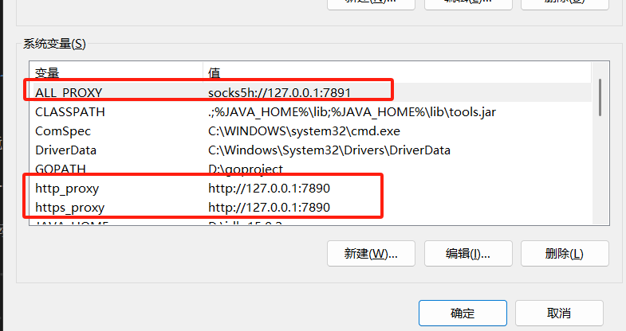
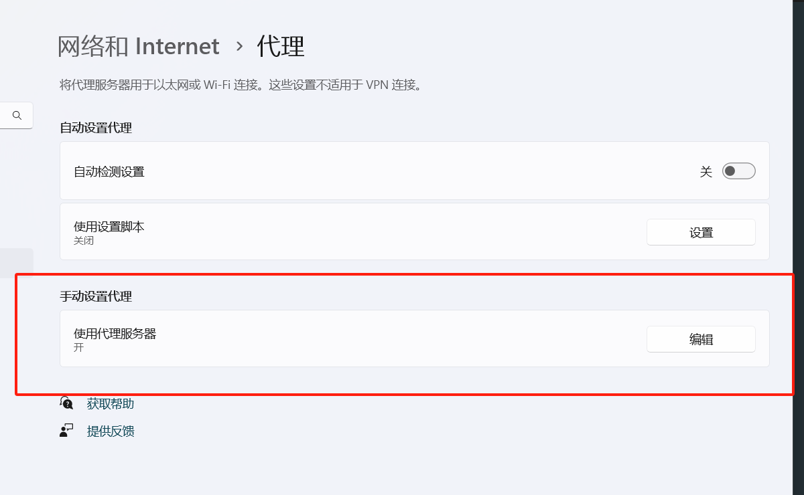

# **单个终端临时代理**
终端输入
```powershell
$env:http_proxy="http://127.0.0.1:7890"
$env:https_proxy="http://127.0.0.1:7890"
$env:ALL_PROXY="socks5h://127.0.0.1:7891"
```

# Windows环境变量全局代理
**会让所有包管理工具拉取依赖自动走代理** 
编辑环境变量（账户和系统环境变量都可以）→点击新建添加下面三条变量名
| 名称          | 值                         |
| ------------- | -------------------------- |
| `http_proxy`  | `http://127.0.0.1:7890`    |
| `https_proxy` | `http://127.0.0.1:7890`    |
| `ALL_PROXY`   | `socks5h://127.0.0.1:7891` |

## CMD等命令行会工具会自动走环境变量的全局代理，浏览器和一般软件不走

**下图可以解释**
- 你为什么打开clash，你的代码项目下载依赖仍然很慢
- 你在windows环境变量里添加了代理，但是访问浏览器或者软件需要访问外网仍然需要手动打开clash


| 工具/应用                                     | 环境变量代理 | 系统代理设置             | 是否需要手动打开 Clash 系统代理 |
| --------------------------------------------- | ------------ | ------------------------ | ------------------------------- |
| CMD / PowerShell / cargo 等命令行工具下载依赖 | ✅ 主动读取   | ❌ 一般不读取取           |                                 |
| 浏览器（Chrome、Edge、Firefox）               | ❌ 不读取     | ✅ 读取系统代理           | ✅ 是                            |
| 一般桌面软件（微信、网易云音乐等）            | ❌ 不读取     | ✅ 读取系统代理（若支持） | ✅ 是                            |

## ⭐环境变量代理和系统代理的区别
### 环境变量
环境变量代理指的是Windwos中编辑环境变量中的配置，如图


### 系统代理
系统代理指的是手动打开clash的系统代理或者在window系统设置中开启代理



